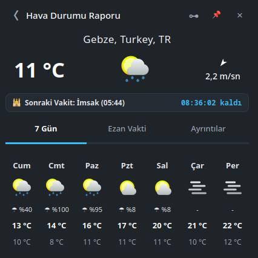
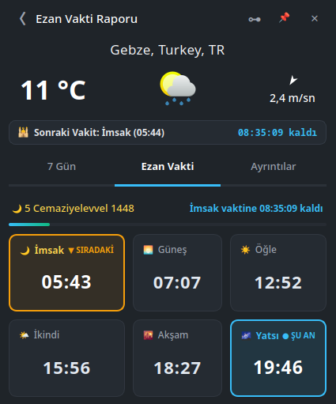
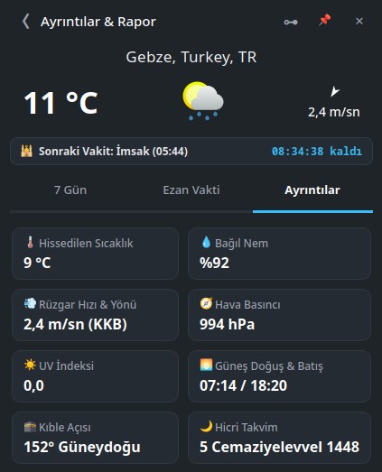

#  Ezan Vakti – Hava Durumu & Namaz Vakitleri (Linux / KDE Plasma)

Sistem tepsisinde (saatin yanında) çalışan, tek dosyalık **AppImage** olarak dağıtılan bir ezan vakti ve hava durumu uygulaması. KDE Plasma'nın Hava Durumu bileşenine benzer bir açılır pencere sunar. Tüm Linux dağıtımlarında çalışır.

##  Ekran görüntüleri

<p align="center">
  
  
  
</p>

##  Özellikler

- **Tepsi simgesi:** Sonraki vakte kalan süre (dakika, bir saatten fazlaysa saat) cami simgesinin içinde düz metin olarak görünür. Simge Anadolu / klasik Osmanlı üslubundadır; vakit yaklaşınca amber renge döner.
- **Açılır pencere (3 sekme):**
  - **7 Gün:** 7 günlük hava durumu, KDE Breeze simgeleriyle.
  - **Ezan Vakti:** İmsak, Güneş, Öğle, İkindi, Akşam, Yatsı; canlı geri sayım, ilerleme çubuğu, Hicri tarih, Kerahat uyarısı.
  - **Ayrıntılar:** Hissedilen sıcaklık, nem, rüzgâr, basınç, UV, gün doğumu / batımı, kıble açısı, Hicri takvim.
- **Diyanet uyumlu vakitler:** Aladhan API, Diyanet yöntemi (Method 13). Aylık vakitler yerel SQLite'ta önbelleğe alınır, internet olmadan da çalışır.
- **Konum:** Türkiye'nin 81 ili listeden seçilir; dünyadan herhangi bir şehir elle girilebilir.
- **Ezan sesleri:** Her vakit için ayrı makam: Sabah – Saba, Öğle – Uşşak, İkindi – Rast, Akşam – Segah, Yatsı – Hicaz. Kendi ses dosyanızı da seçebilirsiniz. Ezan çalarken pencereden, tepsi menüsünden veya tepsi simgesine orta tıkla durdurulabilir.
- **Bildirimler:** Vakit girince ve isteğe bağlı olarak vakitten önce (varsayılan 15 dk) masaüstü bildirimi ve uyarı sesi.
- **Pencere davranışı:** Dışarı tıklayınca kapanır, raptiye ile açık tutulabilir; sürüklenip bırakıldığı yer hatırlanır. Uygulama tek örnek çalışır; ikinci kez başlatmak mevcut pencereyi açar.
- **Tema:** KDE renk şemasını (açık / koyu) takip eder ve tema değişince anında uyum sağlar. `EZAN_THEME=light` veya `dark` ile zorlanabilir.
- **Hafif:** Boştayken işlemci kullanmaz; ses motoru yalnızca çalma sırasında yüklenir.
- **Başlangıçta çalıştır:** Ayarlardan tek tıkla `~/.config/autostart/`.

##  Kurulum

[Releases](../../releases) sayfasından `EzanVakti-x86_64.AppImage` dosyasını indirin:

```bash
chmod +x EzanVakti-x86_64.AppImage
./EzanVakti-x86_64.AppImage
```

KDE menüsüne ve `ezan-vakti` komutuna entegre etmek için depoyu klonlayıp (AppImage aynı klasörde olmalı):

```bash
./install.sh
```

> **Not (Wayland):** Pencerenin sürüklenip konumunun hatırlanabilmesi için uygulama, XWayland varsa onu kullanır. Saf Wayland istiyorsanız `EZAN_NATIVE_WAYLAND=1` ile başlatın (bu durumda konum hatırlama çalışmaz).

##  Kaynaktan çalıştırma ve derleme

Gereksinimler: Python 3.10+, PyQt6 (QtSvg ve QtMultimedia dahil).

```bash
pip install PyQt6
python3 main.py            # çalıştır
python3 main.py --show     # açılışta pencereyi de göster
```

AppImage üretmek için:

```bash
./build_appimage.sh        # PyInstaller + appimagetool (otomatik indirilir)
```

##  Kaynaklar ve lisanslar

- Kod: [GNU GPL v3](LICENSE).
- Namaz vakitleri: [Aladhan API](https://aladhan.com/prayer-times-api). Hava durumu: [Open-Meteo](https://open-meteo.com/) (CC BY 4.0).
- Hava durumu simgeleri: KDE Breeze simge teması (LGPL).
- `assets/*-ezani.mp3` ezan kayıtlarının hakları ilgili sahiplerine aittir; bu depodaki GPL lisansı bu ses dosyalarını kapsamaz.
